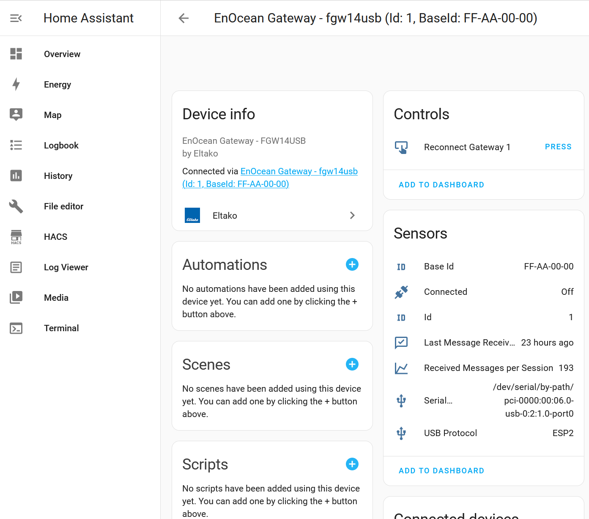

# Usage of Gatways

Hints: 
* Have you checked out the different gatewys and their characteristics? [Supported Gateways](../gateways/readme.md)
* Have you checked out the support for multiple gateways at the same time? [Multiple Gateway Support](../multiple-gateway-support/readme.md)

## How to configure gateways

In order to use a gateway you need to declare the gateway and all devices which shall interact with it in the Home Assistant Configuration (`/config/configuration.yaml`). The configuration can be e.g. edit with [File Editor](https://github.com/home-assistant/addons/tree/master/configurator).

To get familiar with the ELTAKO Integration configuration check out [Update Home Assistant Configuration](../update_home_assistant_configuration.md).

## Gateway Attributes
| Attribute   | Type / Values   | Description |
| :---        | :---        | :---        |
| `id` | Number | Unique arbritary number to identify the gateway. |
| `device_type` | fam14, fgw14usb, fam-usb, enocean-usb300, mgw-lan | The device type defines the gateway model. Base on this information other information is derived. Supported values can be found in [const.py](../../custom_components/eltako/const.py) Supported gateways are described [here](../gateways/readme.md). |
| `base_id` | enocean address format | Gateways can obviously receive and send messages. To send messages they use a hardcoded range of 128 addresses. The base_id is the first address of this range. Base_ids are used to identify the source of a message and to validate the configuration. |
| `devices` | configuration | Devices grouped by Home Assistant platform types. All devices which are listed here will be represented by this device. Device listed more than one in different devices will be recognized as two independent devices. |
| `serial_path` | optional string | for serial paths which won't be auto detected. Can be also used for serial over tcp. |
| `message_delay` | optional number in seconds | delays messages to prevent buffer overflow in gateways for sending many commands at once. Due to different baud rates for serial connection and RS485 bus, which is slower buffer overflow can happen. Default value is 0.01 seconds = 10ms. |
| `auto_reconnect` | True / False | for disabling auto-reconnect function. If not specified: True |
| `bus_gateway_id` | Number | optional id of the canonical bus gateway (usually the FAM14). Received local telegrams from this gateway are translated into that gateway's address space, so devices configured under the FAM14 can also be updated through an FGW14 connected over TCP. |
| `address` | IPv4 or IPv6 | only required for TCP/LAN gateway |
| `port` | Number | only used for TCP/LAN gateway. If not specified: 5100 |


### Example Configuration
```
eltako:
  general_settings:
    fast_status_change: False
    show_dev_id_in_dev_name: True

  gateway:
  - id: 1
    device_type: fgw14usb
    base_id: FF-AA-00-00
    devices:
      light:
      - id: 00-00-00-01
        eep: M5-38-08
        name: "FSR14_4x - 1"
        sender:
          id: 00-00-B0-01
          eep: A5-38-08
```

### Several gateways on one RS485 bus

The FAM14 can be used to read the bus while an FGW14 is used as an additional runtime
connection. Configure the FGW14 as `lan-gw-esp2` when it is reached through a raw TCP-to-
serial bridge and point it at the FAM14 gateway with `bus_gateway_id`. The devices may remain
configured below the FAM14; received local telegrams from the FGW14 are then translated with
the FAM14 base id before they are dispatched to Home Assistant.

```yaml
  gateway:
  - id: 1
    device_type: fam14
    serial_path: /dev/ttyUSB0
    devices:
      light:
      - id: 00-00-00-04
        eep: M5-38-08
        name: Living room
        sender:
          id: 00-00-B0-04
          eep: A5-38-08

  - id: 2
    device_type: lan-gw-esp2
    address: 192.168.1.50
    port: 5100
    bus_gateway_id: 1
```

The referenced gateway must be connected and must have reported its base id. The TCP bridge
must use 57600 baud on the FGW14 side. A second bus gateway can be mapped to the same FAM14 by
using the same `bus_gateway_id`.

## Gateway Features

* Gateways are a bridge between Home Assistant and the devices by receiving and sending messages.
* Gateways are connected via USB to the Home Assistant box. They use the protocol ESP2 or ESP3 based on serial communication. This serial commuinication can automatically reconnected in case of hiccups.


## Gateway Reprentation in Home Assistant

The following information is mainly used for debugging purposes and statistics.

| Entity   | Type | Description |
| :---        | :---        | :---        |
| `Reconnect Gateway` | Push Button | To trigger reconnection manually for testing. Reconnection actaully happens automatically  |
| `ID` | Label | Shows the base id of the gateway. |
| `Connected` | Binary State | Shows if the serial connection (USB) is established. |
| `Last Message Received` | Timestamp | Shows time passed since last message received. |
| `Received Messages per Session` | Counter | Counts messages for current connection. (Hint: There is a history for every sensor.) |
| `Serial Path` | Label | Shows the USB port/path to which the gateway is connected. |
| `USB Protocol` | Label | Shows the protocol for serial connection. |


